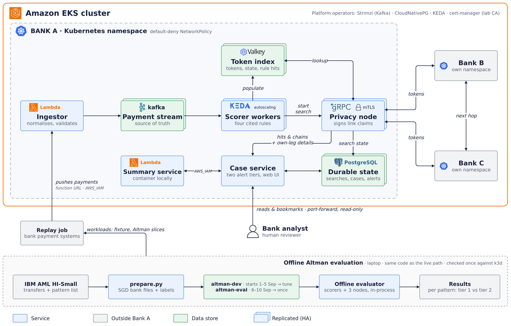

# Privacy Preserving Detection of Cross-Bank Money Mule Chains

CSC3104 Cloud and Distributed Computing project.

Money mules move funds through several banks, and each bank sees only its own part of the chain. Here three simulated banks find such chains together, peer to peer and with no central party, without showing each other their customers, accounts or amounts. Each bank's analyst gets a case that says which banks' rules confirmed each link.



Start with [docs/overview.md](docs/overview.md). To read the code, start with [docs/patterns.md](docs/patterns.md). It covers the ten distributed-systems patterns the system is built from, with the code for each and how to see it work: the log as the source of truth, partition ownership and autoscaling on lag, the delivery chain and idempotent receivers, deadline propagation, backoff with jitter, the transactional outbox, advisory locks, key agreement with no dealer, zero trust, and bulkheads.

## Quick start

Checks and the offline run need only [uv](https://docs.astral.sh/uv/) and `make`:

```sh
git clone git@github.com:10x-Slackers/CSC3104.git && cd CSC3104
make check                                                    # lint, format check, unit tests
uv run python -m mulechain.evaluate workloads/tiny --cases    # all three banks in one process
```

A local cluster also needs Docker, k3d, kubectl, Helm and helmfile. Run the commands from the repository root:

```sh
make k3d                      # create the cluster and deploy the three banks
make replay WORKLOAD=tiny     # send the tiny workload's payments to the banks
make cases                    # each bank's cases
make cluster-check            # the cases, NetworkPolicies and mTLS, checked on the running cluster
make ui BANK=a                # bank A's analyst page on http://localhost:8000 (Ctrl-C to stop)
make k3d-down
```

`make` alone lists every command. AWS (EKS, Lambda, ElastiCache) uses `make eks` and `make eks-down`: see [docs/deployment.md](docs/deployment.md#aws).

## From the diagram to the code

Each box in the diagram is one module in [src/mulechain/](src/mulechain) and one template in the bank's Helm chart ([deploy/charts/bank](deploy/charts/bank)).

| Box in the diagram | Code | Deployed by |
| --- | --- | --- |
| Replay job | [replay.py](src/mulechain/replay.py) | [charts/replay](deploy/charts/replay/templates/job.yaml) |
| Ingestor | [ingestor.py](src/mulechain/ingestor.py) | [ingestor.yaml](deploy/charts/bank/templates/ingestor.yaml); on AWS a Lambda, [lambda.tf](deploy/terraform/lambda.tf) |
| Payment stream (Kafka) | Written by the ingestor, read by the scorer | [kafka.yaml](deploy/charts/bank/templates/kafka.yaml) |
| Scorer workers | [scorer.py](src/mulechain/scorer.py) | [scorer.yaml](deploy/charts/bank/templates/scorer.yaml), with the KEDA autoscaling |
| Token index (Valkey) | Written by the scorer, read by [node/bank.py](src/mulechain/node/bank.py) | [valkey.yaml](deploy/charts/bank/templates/valkey.yaml); on AWS ElastiCache, [cache.tf](deploy/terraform/cache.tf) |
| Privacy node | [node/](src/mulechain/node): `node.py` (the search and the gRPC service), `bank.py`, `claims.py`, `store.py`, `protocol.proto` | [node.yaml](deploy/charts/bank/templates/node.yaml), [certificate.yaml](deploy/charts/bank/templates/certificate.yaml), [keys.yaml](deploy/charts/bank/templates/keys.yaml) |
| Durable state (PostgreSQL) | [node/store.py](src/mulechain/node/store.py), [case/store.py](src/mulechain/case/store.py), through [db.py](src/mulechain/db.py) | [postgres.yaml](deploy/charts/bank/templates/postgres.yaml) |
| Case service | [case/](src/mulechain/case): `app.py` (the analyst page), `store.py` | [case.yaml](deploy/charts/bank/templates/case.yaml) |
| Summary service | [summary.py](src/mulechain/summary.py) | [summary.yaml](deploy/charts/bank/templates/summary.yaml); on AWS a Lambda, [lambda.tf](deploy/terraform/lambda.tf) |
| Bank B, Bank C | The same code, with another `BANK` | One release of the same chart per bank, in [helmfile.yaml.gotmpl](deploy/helmfile.yaml.gotmpl) |
| The dashed namespace border | | [networkpolicy.yaml](deploy/charts/bank/templates/networkpolicy.yaml) |
| `prepare.py` | [prepare.py](src/mulechain/prepare.py) | Run by hand ([docs/data.md](docs/data.md)) |
| Offline evaluator | [evaluate.py](src/mulechain/evaluate.py) | Run by hand ([docs/evaluation.md](docs/evaluation.md)) |

Three modules are shared: [crypto.py](src/mulechain/crypto.py) (keys, tokens, signatures), [db.py](src/mulechain/db.py) (PostgreSQL, or SQLite in tests) and [serverless.py](src/mulechain/serverless.py) (one handler as a container or a Lambda).

## Layout

| Path | What |
| --- | --- |
| [src/mulechain/](src/mulechain) | The services, one module each: `ingestor`, `scorer`, `node/` (privacy node), `case/`, `summary`; and the tools `replay`, `prepare`, `evaluate` |
| [tests/](tests) | Unit tests, including the three banks end to end in one process |
| [deploy/](deploy) | k3d config, helmfile, Helm charts, Terraform for AWS, and checks against a running cluster |
| [workloads/tiny](workloads/tiny) | A 20-payment fixture with planted chains; `mulechain.prepare` generates the larger ones ([docs/data.md](docs/data.md)) |
| [docs/](docs/overview.md) | Overview, patterns, and one doc per area |

## Development

```sh
uv sync --locked
uv run pre-commit install     # ruff on every commit
```

The repository has a Dev Container with the AWS CLI, Terraform, kubectl and Helm. k3d needs Docker on the host, so run the cluster commands there.
