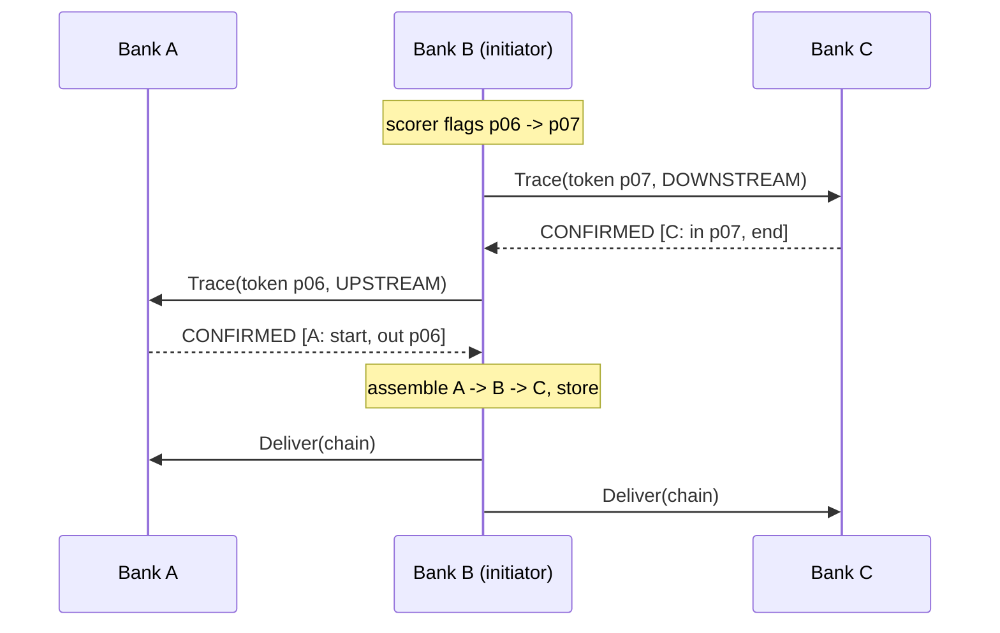

# Privacy node protocol contract

Owner: Isaac (taken over from Zane, 18 Nov 2026) · Partners: Caleb (security), Jia Rui (result delivery, cases), Cindy (search handoff) · Code: `apps/privacy_node/` · Status: **draft**, needs review by Caleb

> [!NOTE]
> **Pending work (decided 30 Oct 2026).** The sections below describe what exists today; these items change it:
> - **Relative deadlines:** drop the absolute `deadline` field and pass `timeout=context.time_remaining()` on nested calls, so clock skew can't time out every search. `SEARCH_SECONDS` and the `Deliver` timeout come from measured p99.9.
> - **Retries:** only at the initiator, with capped exponential backoff and full jitter (`random(0, min(300 s, 10 s × 2^attempts))`, stored as `attempts` and `next_at`), and expiry: after 24 h a search becomes **unresolved**. Fresh `query_id` per retry stays.
> - **Messages:** tokens become 16-byte `bytes` ([security.md](security.md)); a schema test replaces the per-message allowlist walk.
> - **Fully internal chains** posted to the case service as `local` messages ([Result delivery to the case service](#result-delivery-to-the-case-service)).
> - **mTLS** with the authenticated bank matched to `sender`.

Scope: protobuf messages, gRPC service, onward matching, hop and deadline bounds, visited state, stored replies, retries, result delivery and failure handling.

## How a search works

1. A bank's scorer flags a local link: an incoming transfer forwarded on as an outgoing transfer ([streaming.md](streaming.md)). That bank becomes the **initiator** of this one search.
2. The initiator signs its own claim linking the two transfer tokens. It then runs two **legs**:
   - **downstream**: it asks the bank that received the outgoing transfer, "do you hold this token, and does your rule move it on?"
   - **upstream**: it asks the bank that sent the incoming transfer, "do you hold this token, and did it arrive from somewhere you also flagged?"
3. Each bank that holds the token signs a claim and, if its own rule links the transfer onward, forwards the same query one hop further. Replies come back along the same path with every claim collected.
4. The initiator checks every claim, assembles the chain in money-flow order, stores it, and pushes it to every bank that signed a claim (`Deliver`).



Searches start from the scorer's detection, wherever it is, because a chain is often detected in the middle. In the fixture, `m1` (A→B→C) is detected only at B. A detection with an intra-bank leg is not searched: intra-bank transfers have no pairwise token.

## Messages

Source: [`apps/privacy_node/src/privacy_node/privacy_node.proto`](../../apps/privacy_node/src/privacy_node/privacy_node.proto). The recursive schema security test checks every RPC message against `APPROVED_FIELDS` and `FORBIDDEN_FIELDS`. The protobuf runtime field-name walk has been replaced by that test; `ALLOWED_FIELDS` remains test-only. Every received message, including nested claims, is checked for protobuf fields the `.proto` doesn't define (`has_unknown_fields`): a request carrying one is rejected with `INVALID_ARGUMENT`, and a reply carrying one, or a `state` outside the `State` enum, becomes `INVALID_CLAIM` in `Node.call()`, so it is never relayed or stored.

| Message | Fields | Notes |
| --- | --- | --- |
| `TokenRef` | `pair`, `token` | A pair-scoped token of exactly 16 raw bytes, e.g. pair `A-B`. Lookups use `(pair, key_version, token)` ([security.md](security.md)) |
| `TraceRequest` | `query_id`, `sender`, `key_version`, `ref`, `direction`, `hops_remaining`, `deadline`, `visited` | `hops_remaining`, not `hop`: `hop` is a forbidden evaluation label. **pending work:** `deadline` removed |
| `LinkClaim` | `signer`, `recipient`, `query_id`, `key_version`, `in_ref`, `out_ref`, `signature`, `signing_key_version`, `truncated` | "I hold `in_ref` and `out_ref` and my local rule links them." An empty ref means the chain starts or ends here. At the hop limit the bank still names its onward transfer, so a cut is visible in the signed claims |
| `TraceReply` | `state`, `claims` | Claims in path order, nearest bank first |
| `ChainResult` (result delivery) | `chain_digest`, `sender`, `state`, `claims` | `chain_digest`, not `chain_id`: `chain_id` is a forbidden evaluation label |
| `Ack` | `chain_digest` | Returned by `Deliver` once the receiver has stored the result |

Nothing else leaves a bank: no payment IDs, accounts, amounts, timestamps or rule values.

### Signed claim bytes

`claims.claim_bytes` concatenates these fixed-order fields, each preceded by its
four-byte unsigned big-endian byte length. Text uses UTF-8; tokens remain raw bytes:

```text
"csc3104.link-claim", "v1", signer, recipient, query_id, key_version,
signing_key_version, in_ref.pair, in_ref.token, out_ref.pair, out_ref.token,
ASCII("1" if truncated else "0")
```

Missing refs have an empty pair and zero token bytes. Recipient, query ID, both key
versions and truncation are signed. Verification uses trusted
`(signer, signing_key_version)` keys. The signer must belong to each canonical pair;
adjacent claims must share a nonempty transfer and token version with different
signers, and every repeated transfer must have both endpoint banks as witnesses.

Both `Deliver` and case `/results` use `check_result(result, public_keys, bank)` and
store its returned copy. It also checks delivered state, receiver participation,
digest, exactly one sender anchor and query/recipient binding. Open endpoints or
signed truncation force PARTIAL. Full security interfaces: [security.md](security.md).

## Search algorithm

| Item | Decision |
| --- | --- |
| Query ID and idempotency | `query_id` is a UUID per leg. Each bank stores its reply under `(query_id, sender, ref)` and returns the stored reply to a retry. Only final states are stored; `PENDING` and `TIMED_OUT` are recomputed |
| Search ID | `sha256("<bank>:<incoming payment>:<outgoing payment>")`, bank-local only. The same detection always maps to the same search row |
| Hop accounting and limit | `HOP_LIMIT = 4`: a chain holds hops 0–4, so at most 5 transfers. The initiator already knows 2, so the legs share a budget of 3 extra transfers. The downstream leg runs first; the upstream leg gets what is left. `hops_remaining` drops by one each time a bank adds a transfer |
| Deadline | `SEARCH_SECONDS = 10`. One absolute UTC deadline, set by the initiator and passed on unchanged. Each gRPC call's timeout is the time left until it. **pending work:** relative; only the initiator keeps a local deadline, and each nested call gets the time remaining |
| Visited-token handling (loop prevention) | The request carries every token already in the search, including those found by the other leg. A bank whose next token is already visited signs the closing link and stops |
| Branching cap | `BRANCH_CAP = 1`: linear chains only. If a bank's rule finds more than one onward link, it follows the first (lowest payment ID) and the result becomes `PARTIAL` |
| Retries | One attempt per peer call. `UNAVAILABLE`, `RESOURCE_EXHAUSTED` and `ABORTED` → pending and `DEADLINE_EXCEEDED` → timed-out, all re-run by housekeeping; any other peer error → failed, not retried. **pending work:** backoff with jitter and 24 h expiry |
| Which bank assembles the result | The initiator of that search: up-leg claims reversed, then its own claim, then down-leg claims |
| Delivery to all involved banks without a global coordinator | Each initiator delivers its own results. The result row and one outbox row per other signer are written in one transaction; `Deliver` is sent once after a batch of searches and retried until acknowledged (housekeeping). The receiver re-verifies every claim, the digest, and that each leg's claims were signed for one query and the bank that asked; it accepts only confirmed or partial results, and stores a chain whose end is a cut as partial whatever the sender says. Any bank can be an initiator, so no single bank is a dependency for the whole system |
| Chain identity | `chain_digest` = SHA-256 of sorted distinct `(pair, raw token)` identities, framing each UTF-8 pair and token with its four-byte big-endian length, including a transfer named at a cut. Searches started at different banks over the same transfers produce the same digest (tested on loop `o1`, started from B and C). Adopted as the case identity ([case.md](case.md)) |

## Result states

When results combine, the worst state wins, in this order: confirmed < partial < no-match < pending < timed-out < failed < invalid-claim.

| State | Meaning |
| --- | --- |
| confirmed | Both legs reached a natural start/end or closed a loop, and every claim verified |
| no-match | A queried bank does not hold the token for that pair and direction (or the sender is not in the pair) |
| partial | Cut by the hop limit or the branching cap. **Final**: stored and delivered as partial evidence |
| failed | A peer rejected or failed the query (any gRPC error other than `UNAVAILABLE`, `RESOURCE_EXHAUSTED`, `ABORTED` or `DEADLINE_EXCEEDED`). Final, not retried, not stored |
| pending | A needed bank was unreachable. Claims from available banks are kept; the search is retried by housekeeping |
| timed-out | The deadline passed. Retried by housekeeping |
| invalid-claim | A signature, signer, token continuity, query ID or recipient check failed. Never stored as a chain or delivered; its search row keeps no digest |

Only `confirmed` and `partial` results become chain rows and are delivered. A later `confirmed` result upgrades a `partial` row with the same digest; nothing downgrades a confirmed row.

## Durable state (per bank)

`apps/privacy_node/src/privacy_node/store.py`: the bank's PostgreSQL in the cluster (`--db postgresql://…`, the chart's `postgres-app` Secret), shared by the node's replicas; a SQLite file, or memory by default, for tests and local runs. The same SQL runs on both. After PostgreSQL restarts, the call that finds the connection broken fails and the next one reconnects.

| Table | Key | Purpose |
| --- | --- | --- |
| `replies` | `(query_id, sender\|ref)` | Stored final replies for idempotent retries |
| `searches` | `search_id` | Every search this bank started and its latest state |
| `chains` | `chain_digest` | One row per chain at each bank; the seed for one alert per bank ([case.md](case.md)) |
| `outbox` | `(chain_digest, bank)` | Results not yet acknowledged by an involved bank |
| `case_outbox` | `(key, kind)` | Messages not yet stored by this bank's case service |

## Failure contract

- A missing bank can't confirm an unknown link. A search that needs it becomes **pending**; it keeps the claims other banks gave, and no chain row is created. Searches that don't need that bank keep going.
- **Resuming after recovery:** housekeeping (every 10 s) re-runs every pending or timed-out search, then redelivers every unacknowledged outbox row. An error in one search is logged and the pass carries on with the rest and with delivery. Tested: C offline → pending; C back → confirmed and stored at A, B and C.
- **Initiator restart:** pending searches and outbox rows are durable, so they resume after a restart, since they are in PostgreSQL (`--db`).
- **Dead letter:** a delivery the receiver rejects with `INVALID_ARGUMENT` is marked `dead` in the outbox and logged, instead of being resent every pass. Other errors stay in the outbox and are retried. A later upgrade of the same chain clears the mark, since it is a new message.
- **Retained-state lifetimes (**pending work**):** stored replies expire after the search deadline plus a margin; pending searches expire after 24 h as unresolved; outbox rows are kept until acknowledged or dead-lettered.
- **"Exactly one alert"** holds for eventual recovery with intact storage, not permanent data loss. The protocol side gives one `chains` row per digest at each bank, tested under repeated searches and redelivery.
- **Replicas:** with the chart's `ha` flag a bank runs 2 node replicas behind one Service, sharing the store in PostgreSQL (`INSERT ... ON CONFLICT`) and splitting the scorer's hits through the `privacy-node` consumer group. Each housekeeping pass takes a session-level `pg_try_advisory_lock`, so one replica retries and redelivers at a time, and PostgreSQL releases the lock if that replica's session dies. Each replica still reloads its own keys and rechecks its own deferred chain hits. Receivers are idempotent, so a result sent twice (say, after a PostgreSQL restart drops the lock mid-pass) is harmless.
- **Health:** a gRPC health service on a separate plaintext port (`--health-port`, 50052), since the kubelet's gRPC probe can't present a client certificate. It starts only once the node has connected to its state (Valkey and the store) and started its server, so until then the probe fails.

## Result delivery to the case service

With `--valkey-url` and `--case-url`, the node is the **only writer** to its own bank's case service, through a transactional outbox (`case_outbox`), so a case-service outage can't stall the scorer or searches. Each payload is idempotent:

| Payload | Key | Contents |
| --- | --- | --- |
| Chain | `chain_digest` | The `ChainResult`, plus this bank's own legs from the token index. Queued in the same transaction as the `chains` row, when it is inserted or upgraded, at the initiator and at every bank it's delivered to |
| Tier 1 hit | hit ID | The scorer's hit from Valkey: rule and the hit's payments as legs. Queued for every hit in the `hits` stream |
| Pending search | search ID | Queued once, when a search first ends pending or timed out. `waiting_for` names the first bank on each stuck leg; a bank further along isn't known to the initiator. The later chain joins the same case by its transfers |
| Fully internal chain | hit ID | **pending work:** not sent yet |

Own-leg details travel only inside the bank, never in a peer message. The case service never reads Valkey.

**agreed** (Isaac for the node, 18 Nov): the JSON format of each message and a shared sample, [`apps/case/fixtures/node_messages.json`](../../apps/case/fixtures/node_messages.json), are in [case.md](case.md#node-messages). Housekeeping (every 10 s, as for `Deliver` in Valkey mode) posts every unacknowledged row to `<case-url>/results`; a 200 acknowledges it, a 422 (not evidence) dead-letters it, and any other status leaves it for the next pass. If the service can't be reached, the pass stops there and the next one starts again. `test_valkey_node.py` runs the tiny fixture through the scorer, Valkey, three nodes and three case stores, and gets the offline evaluator's cases and tiers at every bank.

### Searches from Valkey

With `--valkey-url` the node reads the scorer's keys ([streaming.md](streaming.md#valkey-layout-draft-cindy--zane)) and keeps no copy: `tok:` for peer lookups, `pay:` for the bank to ask next and for own legs, `link:` for onward and backward links. It reads the `hits` stream in the consumer group `privacy-node` (consumer name: the pod's hostname), so replicas share the hits; a hit is acknowledged only after its search and case messages are stored. A consumer reads its own unacknowledged hits again first (left by an error), then claims (`XAUTOCLAIM`) any another consumer has left unacknowledged for 60 s, since a replaced pod gets a new name. A hit whose `hit:` or `pay:` entries have expired is logged and acknowledged, so it can't block the hits behind it. If Valkey can't be reached while answering a `Trace`, the node returns `UNAVAILABLE`, so the asker's search stays pending and is retried. Each `chain` hit starts a search from its link. If an end of the link doesn't yet reach a cross-bank payment, housekeeping looks again for the ingestion grace period: the intra-bank link it needs may be on another account, written later by another scorer replica, and such a link raises no hit. Known limitation: the hit is acknowledged while its recheck is only in memory, so a pod restart before the recheck starts a search drops it, even if the missing link has arrived; a later hit covering the path still starts the search. Searches start from chain hits only: the fast rule writes no hit, but every fast link between two cross-bank payments is also a chain link.

**Intra-bank hops:** when a link reaches an intra-bank payment, the node carries on from that payment's other leg, up to 4 internal hops, until it reaches a cross-bank payment. So B's one claim links the cross-bank payment in to the cross-bank payment out, and the internal hops never leave the bank. A chain hit whose money starts or stays inside the bank (no cross-bank payment at one end) starts no search; its hit still makes a Tier 1 case.

## Running and testing

The node CLI uses only `--key-directory ROOT`, containing `<bank>/active.json` and
the private/public/trusted layout in [security.md](security.md). The manifest selects
active/query/signing versions and trusted peer readiness. It is reread on reload;
explicit key-path options and `--key-config` have been removed. Each peer call opens
and closes its own channel, rereading renewed TLS credentials. This preserves
connection-level Service balancing across replicas; extra handshakes are accepted.


```sh
uv run pytest apps/privacy_node             # protocol tests; set NODE_TEST_DATABASE_URL=postgresql://… to run the store tests on PostgreSQL too
uv run python -m privacy_node.demo          # three banks on localhost, prints each trace
uv run python -m privacy_node.keys .secrets A --key-version k1 # one bank; exchange public files only
```

Regenerate the stubs after editing the `.proto` (from the repo root):

```sh
uv run python -m grpc_tools.protoc -Iapps/privacy_node/src --python_out=apps/privacy_node/src --pyi_out=apps/privacy_node/src --grpc_python_out=apps/privacy_node/src apps/privacy_node/src/privacy_node/privacy_node.proto
```

Tiny-fixture results (`demo.py`):

| Search from | Detection | State | Chain |
| --- | --- | --- | --- |
| B | p06 → p07 | confirmed | `m1`: A → B → C |
| B, C | p10 → p11, p11 → p12 | confirmed | `o1`: one digest from both starts |
| A, B, B, C, C | `v1` links | partial | 5 transfers followed, the 6th named at the cut; one digest from all starts |
| — | `l1`, `x1`, ordinary | no search | no local detection |

Each bank stores 3 chains (2 confirmed, 1 partial) after all searches.

## Interfaces

Agreed contract first ([conventions](../README.md#conventions)): the producer adds one sample message here, and both sides' tests load it.

| Interface | From → to | Pins down | Status | Agree by |
| --- | --- | --- | --- | --- |
| `.proto` v1 ([protocol.md](protocol.md#messages)) | Isaac ↔ Caleb | `bytes` token, no absolute deadline, unknown fields rejected, the schema test's allow and forbid lists | **draft**, sample TODO | Wed 4 Nov |
| Node → case service ([protocol.md](protocol.md#result-delivery-to-the-case-service)) | Isaac → Jia Rui | Payloads (chains with own legs, Tier 1 hits, pending and internal cases), keys, retry and dead letter | **agreed** (Isaac, 18 Nov), sample [`node_messages.json`](../../apps/case/fixtures/node_messages.json); internal chains pending | Wed 4 Nov |

Also part of: [Token and key API](security.md#interfaces), [Valkey layout](streaming.md#interfaces), [Alert tiers](case.md#interfaces), [`check_result`](security.md#interfaces).

## Open

- [ ] Review the claim bytes, `ALLOWED_FIELDS` and the `chain_id` → `chain_digest` rename (Caleb).
- [ ] mTLS: use `privacy-node-tls`, map the client certificate's SAN to a bank, and reject requests whose `sender` doesn't match; today `sender` is trusted from the message (Isaac, with Caleb; **pending work**).
- [x] Move `store.py` to PostgreSQL, then test two replicas per bank (`test_store.py`).
- [x] `BRANCH_CAP = 1` and `HOP_LIMIT = 4`, checked by a 4/6/8 sweep; shared state moves to Valkey and PostgreSQL.
- [x] `chain_digest` is the case identity; the case service merges overlapping partial chains by shared transfers.
- [x] Retention lifetimes: see the [failure contract](#failure-contract).
- [x] Late events: keep the ingestion grace (`--ingestion-grace-seconds`), with its default set from measured ingest lag and `retry_until` stored in the `searches` row.
