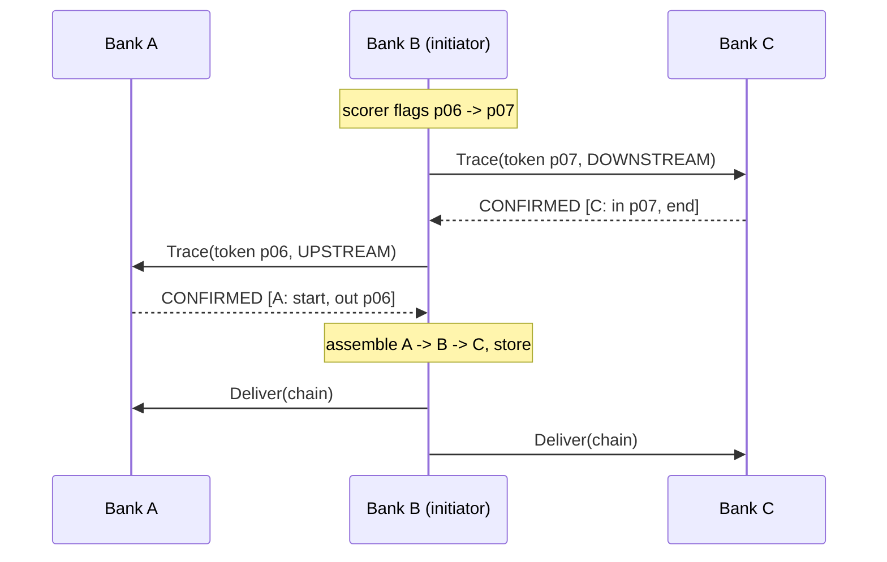

# Privacy node protocol contract

Owner: Zane · Partners: Caleb (security), Jia Rui (result delivery, cases), Isaac (fault tests), Cindy (search handoff) · Code: `apps/privacy_node/` · Status: **draft**, needs review by Caleb

> [!NOTE]
> **Pending work (decided 30 Oct 2026).** The sections below describe what exists today; these items change it:
> - **Relative deadlines:** drop the absolute `deadline` field and pass `timeout=context.time_remaining()` on nested calls, so clock skew can't time out every search. `SEARCH_SECONDS` and the `Deliver` timeout come from measured p99.9.
> - **Retries:** only at the initiator, with capped exponential backoff and full jitter (`random(0, min(300 s, 10 s × 2^attempts))`, stored as `attempts` and `next_at`), and expiry: after 24 h a search becomes **unresolved**. Fresh `query_id` per retry stays.
> - **Messages:** tokens become 16-byte `bytes` ([security.md](security.md)); a schema test replaces the per-message allowlist walk.
> - **State and replicas:** `store.py` moves to PostgreSQL; token index and local links are read from Valkey ([streaming.md](streaming.md#search-handoff)); 2 replicas, with housekeeping under a PostgreSQL advisory lock; a gRPC health service (not serving until state is ready).
> - **Delivery to the case service** through the same outbox ([Result delivery to the case service](#result-delivery-to-the-case-service)); one shared `check_result` (Caleb) used by `Deliver` and the case service.
> - **mTLS** with the authenticated bank matched to `sender`.

Scope: protobuf messages, gRPC service, onward matching, hop and deadline bounds, visited state, stored replies, retries, result delivery and failure handling.

## How a search works

1. A bank's scorer flags a local link: an incoming transfer forwarded on as an outgoing transfer ([streaming.md](streaming.md)). That bank becomes the **initiator** of this one search.
2. The initiator signs its own claim linking the two transfer tokens. It then runs two **legs**:
   - **downstream**: it asks the bank that received the outgoing transfer, "do you hold this token, and does your rule move it on?"
   - **upstream**: it asks the bank that sent the incoming transfer, "do you hold this token, and did it arrive from somewhere you also flagged?"
3. Each bank that holds the token signs a claim and, if its own rule links the transfer onward, forwards the same query one hop further. Replies come back along the same path with every claim collected.
4. The initiator checks every claim, assembles the chain in money-flow order, stores it, and pushes it to every bank that signed a claim (`Deliver`).



Searches start from the scorer's detection, wherever it is, because a chain is often detected in the middle. In the fixture, `m1` (A→B→C) is detected only at B. A detection with an intra-bank leg is not searched: intra-bank transfers have no pairwise token.

## Messages

Source: [`apps/privacy_node/src/privacy_node/privacy_node.proto`](../../apps/privacy_node/src/privacy_node/privacy_node.proto). Every serialized message passes `check_peer_payload` against `ALLOWED_FIELDS` in `claims.py` before sending. Every received message, including nested claims, is checked for protobuf fields the `.proto` doesn't define (`has_unknown_fields`): a request carrying one is rejected with `INVALID_ARGUMENT`, and a reply carrying one, or a `state` outside the `State` enum, becomes `INVALID_CLAIM` in `Node.call()`, so it is never relayed or stored.

| Message | Fields | Notes |
| --- | --- | --- |
| `TokenRef` | `pair`, `token` | A pair-scoped token, e.g. pair `A-B`. Lookups use `(pair, key_version, token)` ([security.md](security.md)) |
| `TraceRequest` | `query_id`, `sender`, `key_version`, `ref`, `direction`, `hops_remaining`, `deadline`, `visited` | `hops_remaining`, not `hop`: `hop` is a forbidden evaluation label. **pending work:** `deadline` removed |
| `LinkClaim` | `signer`, `recipient`, `query_id`, `key_version`, `in_ref`, `out_ref`, `signature` | "I hold `in_ref` and `out_ref` and my local rule links them." An empty ref means the chain starts or ends here. At the hop limit the bank still names its onward transfer, so a cut is visible in the signed claims |
| `TraceReply` | `state`, `claims` | Claims in path order, nearest bank first |
| `ChainResult` (result delivery) | `chain_digest`, `sender`, `state`, `claims` | `chain_digest`, not `chain_id`: `chain_id` is a forbidden evaluation label |
| `Ack` | `chain_digest` | Returned by `Deliver` once the receiver has stored the result |

Nothing else leaves a bank: no payment IDs, accounts, amounts, timestamps or rule values.

### Signed claim bytes

The signature covers exactly this compact ASCII JSON (`claims.claim_bytes`):

```text
["csc3104.link-claim","v1",signer,recipient,query_id,key_version,in_pair,in_token,out_pair,out_token]
```

A missing ref is written as two empty strings. The domain string stops the signature being reused for another message type. `recipient` and `query_id` bind the claim to one query, so it can't be replayed into a different search.

A claim is valid only if the signature verifies with the signer's configured public key **and** the signer is a bank in the pair of every ref it vouches for. A chain is valid only if every claim is valid and each claim's `out_ref` equals the next claim's `in_ref`.

## Search algorithm

| Item | Decision |
| --- | --- |
| Query ID and idempotency | `query_id` is a UUID per leg. Each bank stores its reply under `(query_id, sender, ref)` and returns the stored reply to a retry. Only final states are stored; `PENDING` and `TIMED_OUT` are recomputed |
| Search ID | `sha256("<bank>:<incoming payment>:<outgoing payment>")`, bank-local only. The same detection always maps to the same search row |
| Hop accounting and limit | `HOP_LIMIT = 4`: a chain holds hops 0–4, so at most 5 transfers. The initiator already knows 2, so the legs share a budget of 3 extra transfers. The downstream leg runs first; the upstream leg gets what is left. `hops_remaining` drops by one each time a bank adds a transfer |
| Deadline | `SEARCH_SECONDS = 10`. One absolute UTC deadline, set by the initiator and passed on unchanged. Each gRPC call's timeout is the time left until it. **pending work:** relative; only the initiator keeps a local deadline, and each nested call gets the time remaining |
| Visited-token handling (loop prevention) | The request carries every token already in the search, including those found by the other leg. A bank whose next token is already visited signs the closing link and stops |
| Branching cap | `BRANCH_CAP = 1`: linear chains only. If a bank's rule finds more than one onward link, it follows the first (lowest payment ID) and the result becomes `PARTIAL` |
| Retries | One attempt per peer call. `UNAVAILABLE`, `RESOURCE_EXHAUSTED` and `ABORTED` → pending and `DEADLINE_EXCEEDED` → timed-out, all re-run by housekeeping; any other peer error → failed, not retried. **pending work:** backoff with jitter and 24 h expiry |
| Which bank assembles the result | The initiator of that search: up-leg claims reversed, then its own claim, then down-leg claims |
| Delivery to all involved banks without a global coordinator | Each initiator delivers its own results. The result row and one outbox row per other signer are written in one transaction; `Deliver` is sent once after a batch of searches and retried until acknowledged (housekeeping). The receiver re-verifies every claim, the digest, and that each leg's claims were signed for one query and the bank that asked; it accepts only confirmed or partial results, and stores a chain whose end is a cut as partial whatever the sender says. Any bank can be an initiator, so no single bank is a dependency for the whole system |
| Chain identity | `chain_digest` = SHA-256 of the sorted set of transfer tokens in the chain, including a transfer named at a cut. Searches started at different banks over the same transfers produce the same digest (tested on loop `o1`, started from B and C). Adopted as the case identity ([case.md](case.md)) |

## Result states

When results combine, the worst state wins, in this order: confirmed < partial < no-match < pending < timed-out < failed < invalid-claim.

| State | Meaning |
| --- | --- |
| confirmed | Both legs reached a natural start/end or closed a loop, and every claim verified |
| no-match | A queried bank does not hold the token for that pair and direction (or the sender is not in the pair) |
| partial | Cut by the hop limit or the branching cap. **Final**: stored and delivered as partial evidence |
| failed | A peer rejected or failed the query (any gRPC error other than `UNAVAILABLE`, `RESOURCE_EXHAUSTED`, `ABORTED` or `DEADLINE_EXCEEDED`). Final, not retried, not stored |
| pending | A needed bank was unreachable. Claims from available banks are kept; the search is retried by housekeeping |
| timed-out | The deadline passed. Retried by housekeeping |
| invalid-claim | A signature, signer, token continuity, query ID or recipient check failed. Never stored as a chain or delivered; its search row keeps no digest |

Only `confirmed` and `partial` results become chain rows and are delivered. A later `confirmed` result upgrades a `partial` row with the same digest; nothing downgrades a confirmed row.

## Durable state (per bank)

`apps/privacy_node/src/privacy_node/store.py`, SQLite for M2. The same SQL moves to the bank's PostgreSQL for M3.

| Table | Key | Purpose |
| --- | --- | --- |
| `replies` | `(query_id, sender\|ref)` | Stored final replies for idempotent retries |
| `searches` | `search_id` | Every search this bank started and its latest state |
| `chains` | `chain_digest` | One row per chain at each bank; the seed for one alert per bank ([case.md](case.md)) |
| `outbox` | `(chain_digest, bank)` | Results not yet acknowledged by an involved bank |

## Failure contract

- A missing bank can't confirm an unknown link. A search that needs it becomes **pending**; it keeps the claims other banks gave, and no chain row is created. Searches that don't need that bank keep going.
- **Resuming after recovery:** housekeeping (every 10 s) re-runs every pending or timed-out search, then redelivers every unacknowledged outbox row. An error in one pass is logged and the next pass runs as normal. Tested: C offline → pending; C back → confirmed and stored at A, B and C.
- **Initiator restart:** pending searches and outbox rows are durable, so they resume after a restart, provided the store file survives (`--db`); M3 moves it to PostgreSQL.
- **Dead letter:** a delivery the receiver rejects with `INVALID_ARGUMENT` is marked `dead` in the outbox and logged, instead of being resent every pass. Other errors stay in the outbox and are retried. A later upgrade of the same chain clears the mark, since it is a new message.
- **Retained-state lifetimes (**pending work**):** stored replies expire after the search deadline plus a margin; pending searches expire after 24 h as unresolved; outbox rows are kept until acknowledged or dead-lettered.
- **"Exactly one alert"** holds for eventual recovery with intact storage, not permanent data loss. The protocol side gives one `chains` row per digest at each bank, tested under repeated searches and redelivery.
- Concurrent replicas will share query state in PostgreSQL (`INSERT ... ON CONFLICT DO NOTHING`). Until then, run one replica per bank. **pending work:** 2 replicas; each housekeeping pass takes a session-level `pg_try_advisory_lock`, so one replica works at a time and the lock is released if its session dies. Duplicates are harmless because receivers are idempotent.

## Result delivery to the case service

**pending work (Zane, with Jia Rui):** Nothing calls the case service's `POST /results` today. The node becomes the **only writer** to its own bank's case service, through the transactional outbox (a `case` destination row), so a case-service outage can't stall the scorer or searches. Each payload is idempotent:

| Payload | Key | Contents |
| --- | --- | --- |
| Chain | `chain_digest` | The `ChainResult`, plus this bank's own legs (payment ID, account, amount) from the token index. Sent when the `chains` row is inserted or upgraded |
| Tier 1 hit | hit ID | The scorer's hit from Valkey: rule, account, payments |
| Pending search | search ID | "Waiting for bank X", upgraded when the retry confirms |
| Fully internal chain | hit ID | A local-only chain, with no peer search |

Own-leg details travel only inside the bank, never in a peer message. The case service never reads Valkey.

## Running and testing

```sh
uv run pytest apps/privacy_node             # 40 protocol tests
uv run python -m privacy_node.demo          # three banks on localhost, prints each trace
uv run python -m privacy_node.keys .secrets # lab keys (git-ignored)
```

Regenerate the stubs after editing the `.proto` (from the repo root):

```sh
uv run python -m grpc_tools.protoc -Iapps/privacy_node/src --python_out=apps/privacy_node/src --pyi_out=apps/privacy_node/src --grpc_python_out=apps/privacy_node/src apps/privacy_node/src/privacy_node/privacy_node.proto
```

Tiny-fixture results (`demo.py`):

| Search from | Detection | State | Chain |
| --- | --- | --- | --- |
| B | p06 → p07 | confirmed | `m1`: A → B → C |
| B, C | p10 → p11, p11 → p12 | confirmed | `o1`: one digest from both starts |
| A, B, B, C, C | `v1` links | partial | 5 transfers followed, the 6th named at the cut; one digest from all starts |
| — | `l1`, `x1`, ordinary | no search | no local detection |

Each bank stores 3 chains (2 confirmed, 1 partial) after all searches.

## Interfaces

Agreed contract first ([conventions](../README.md#conventions)): the producer adds one sample message here, and both sides' tests load it.

| Interface | From → to | Pins down | Status | Agree by |
| --- | --- | --- | --- | --- |
| `.proto` v1 ([protocol.md](protocol.md#messages)) | Zane ↔ Caleb | `bytes` token, no absolute deadline, unknown fields rejected, the schema test's allow and forbid lists | **draft**, sample TODO | Wed 4 Nov |
| Node → case service ([protocol.md](protocol.md#result-delivery-to-the-case-service)) | Zane → Jia Rui | Payloads (chains with own legs, Tier 1 hits, pending and internal cases), keys, retry and dead letter | **draft**, sample TODO | Wed 4 Nov |

Also part of: [Token and key API](security.md#interfaces), [Valkey layout](streaming.md#interfaces), [Alert tiers](case.md#interfaces), [`check_result`](security.md#interfaces).

## Open

- [ ] Review the claim bytes, `ALLOWED_FIELDS` and the `chain_id` → `chain_digest` rename (Caleb).
- [ ] mTLS: use `privacy-node-tls`, map the client certificate's SAN to a bank, and reject requests whose `sender` doesn't match; today `sender` is trusted from the message (Zane, with Caleb; **pending work**).
- [ ] Move `store.py` to PostgreSQL, then test two replicas per bank (Zane; **pending work**).
- [x] `BRANCH_CAP = 1` and `HOP_LIMIT = 4`, checked by a 4/6/8 sweep; shared state moves to Valkey and PostgreSQL.
- [x] `chain_digest` is the case identity; the case service merges overlapping partial chains by shared transfers.
- [x] Retention lifetimes: see the [failure contract](#failure-contract).
- [x] Late events: keep the ingestion grace (`--ingestion-grace-seconds`), with its default set from measured ingest lag and `retry_until` stored in the `searches` row.
