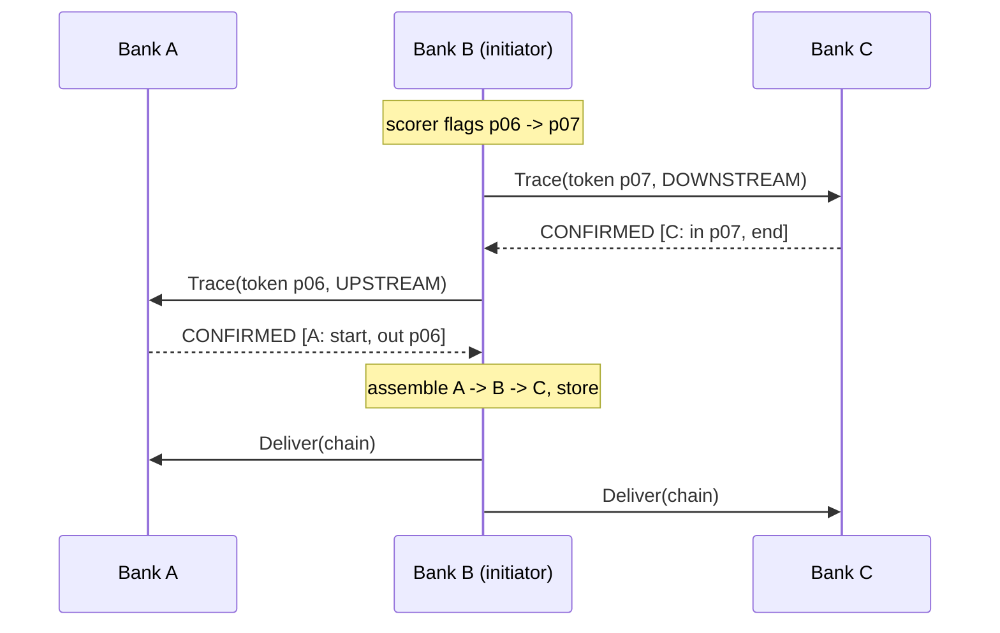

# Privacy node protocol contract

Owner: Zane · Partners: Caleb (security), Jia Rui (result delivery, cases), Isaac (fault tests), Cindy (search handoff) · Code: `apps/privacy_node/` · Status: **draft**, needs review by Caleb

Scope: protobuf messages, gRPC service, onward matching, hop and deadline bounds, visited state, stored replies, retries, result delivery and failure handling.

## How a search works

1. A bank's scorer flags a local link: an incoming transfer forwarded on as an outgoing transfer ([streaming.md](streaming.md)). That bank becomes the **initiator** of this one search.
2. The initiator signs its own claim linking the two transfer tokens. It then runs two **legs**:
   - **downstream**: it asks the bank that received the outgoing transfer, "do you hold this token, and does your rule move it on?"
   - **upstream**: it asks the bank that sent the incoming transfer, "do you hold this token, and did it arrive from somewhere you also flagged?"
3. Each bank that holds the token signs a claim and, if its own rule links the transfer onward, forwards the same query one hop further. Replies come back along the same path with every claim collected.
4. The initiator checks every claim, assembles the chain in money-flow order, stores it, and pushes it to every bank that signed a claim (`Deliver`).



Searches start from the scorer's detection, wherever it is, because a chain is often detected in the middle. In the fixture, `m1` (A→B→C) is detected only at B. A detection with an intra-bank leg is not searched: intra-bank transfers have no pairwise token.

## Messages

Source: [`apps/privacy_node/privacy_node.proto`](../../apps/privacy_node/privacy_node.proto). Every serialized message passes `check_peer_payload` against `ALLOWED_FIELDS` in `claims.py` before sending.

| Message | Fields | Notes |
| --- | --- | --- |
| `TokenRef` | `pair`, `token` | A pair-scoped token, e.g. pair `A-B`. Lookups use `(pair, key_version, token)` ([security.md](security.md)) |
| `TraceRequest` | `query_id`, `sender`, `key_version`, `ref`, `direction`, `hops_remaining`, `deadline`, `visited` | `hops_remaining`, not `hop`: `hop` is a forbidden evaluation label |
| `LinkClaim` | `signer`, `recipient`, `query_id`, `key_version`, `in_ref`, `out_ref`, `signature` | "I hold `in_ref` and `out_ref` and my local rule links them." An empty ref means the chain starts or ends here. At the hop limit the bank still names its onward transfer, so a cut is visible in the signed claims |
| `TraceReply` | `state`, `claims` | Claims in path order, nearest bank first |
| `ChainResult` (result delivery) | `chain_digest`, `sender`, `state`, `claims` | `chain_digest`, not `chain_id`: `chain_id` is a forbidden evaluation label |
| `Ack` | `chain_digest` | Returned by `Deliver` once the receiver has stored the result |

Nothing else leaves a bank: no payment IDs, accounts, amounts, timestamps or rule values.

### Signed claim bytes

The signature covers exactly this compact ASCII JSON (`claims.claim_bytes`):

```text
["csc3104.link-claim","v1",signer,recipient,query_id,key_version,in_pair,in_token,out_pair,out_token]
```

A missing ref is written as two empty strings. The domain string stops the signature being reused for another message type. `recipient` and `query_id` bind the claim to one query, so it can't be replayed into a different search.

A claim is valid only if the signature verifies with the signer's configured public key **and** the signer is a bank in the pair of every ref it vouches for. A chain is valid only if every claim is valid and each claim's `out_ref` equals the next claim's `in_ref`.

## Search algorithm

| Item | Decision |
| --- | --- |
| Query ID and idempotency | `query_id` is a UUID per leg. Each bank stores its reply under `(query_id, sender, ref)` and returns the stored reply to a retry. Only final states are stored; `PENDING` and `TIMED_OUT` are recomputed |
| Search ID | `sha256("<bank>:<incoming payment>:<outgoing payment>")`, bank-local only. The same detection always maps to the same search row |
| Hop accounting and limit | `HOP_LIMIT = 4` (matches `prepare.py`): a chain holds hops 0–4, so at most 5 transfers. The initiator already knows 2, so the legs share a budget of 3 extra transfers. The downstream leg runs first; the upstream leg gets what is left. `hops_remaining` drops by one each time a bank adds a transfer |
| Deadline | `SEARCH_SECONDS = 10`. One absolute UTC deadline, set by the initiator and passed on unchanged. Each gRPC call's timeout is the time left until it |
| Visited-token handling (loop prevention) | The request carries every token already in the search, including those found by the other leg. A bank whose next token is already visited signs the closing link and stops |
| Branching cap | `BRANCH_CAP = 1`: linear chains only. If a bank's rule finds more than one onward link, it follows the first (lowest payment ID) and the result becomes `PARTIAL` |
| Retries | One attempt per peer call. `UNAVAILABLE` → pending and `DEADLINE_EXCEEDED` → timed-out, both re-run by housekeeping; any other peer error → failed, not retried |
| Which bank assembles the result | The initiator of that search: up-leg claims reversed, then its own claim, then down-leg claims |
| Delivery to all involved banks without a global coordinator | Each initiator delivers its own results. The result row and one outbox row per other signer are written in one transaction; `Deliver` is sent once after a batch of searches and retried until acknowledged (housekeeping). The receiver re-verifies every claim, the digest, and that each leg's claims were signed for one query and the bank that asked; it accepts only confirmed or partial results, and stores a chain whose end is a cut as partial whatever the sender says. Any bank can be an initiator, so no single bank is a dependency for the whole system |
| Chain identity | `chain_digest` = SHA-256 of the sorted set of transfer tokens in the chain, including a transfer named at a cut. Searches started at different banks over the same transfers produce the same digest (tested on loop `o1`, started from B and C). Proposed to Jia Rui as the case identity |

## Result states

When results combine, the worst state wins, in this order: confirmed < partial < no-match < pending < timed-out < failed < invalid-claim.

| State | Meaning |
| --- | --- |
| confirmed | Both legs reached a natural start/end or closed a loop, and every claim verified |
| no-match | A queried bank does not hold the token for that pair and direction (or the sender is not in the pair) |
| partial | Cut by the hop limit or the branching cap. **Final**: stored and delivered as partial evidence |
| failed | A peer rejected or failed the query (any gRPC error other than unavailable or deadline). Final, not retried, not stored |
| pending | A needed bank was unreachable. Claims from available banks are kept; the search is retried by housekeeping |
| timed-out | The deadline passed. Retried by housekeeping |
| invalid-claim | A signature, signer, token continuity, query ID or recipient check failed. Never stored as a chain or delivered; its search row keeps no digest |

Only `confirmed` and `partial` results become chain rows and are delivered. A later `confirmed` result upgrades a `partial` row with the same digest; nothing downgrades a confirmed row.

## Durable state (per bank)

`apps/privacy_node/store.py`, SQLite for M2. The same SQL moves to the bank's PostgreSQL for M3.

| Table | Key | Purpose |
| --- | --- | --- |
| `replies` | `(query_id, sender\|ref)` | Stored final replies for idempotent retries |
| `searches` | `search_id` | Every search this bank started and its latest state |
| `chains` | `chain_digest` | One row per chain at each bank; the seed for one alert per bank ([case.md](case.md)) |
| `outbox` | `(chain_digest, bank)` | Results not yet acknowledged by an involved bank |

## Failure contract

- A missing bank can't confirm an unknown link. A search that needs it becomes **pending**; it keeps the claims other banks gave, and no chain row is created. Searches that don't need that bank keep going.
- **Resuming after recovery:** housekeeping (every 10 s) re-runs every pending or timed-out search, then redelivers every unacknowledged outbox row. An error in one pass is logged and the next pass runs as normal. Tested: C offline → pending; C back → confirmed and stored at A, B and C.
- **Initiator restart:** pending searches and outbox rows are durable, so they resume after a restart, provided the store survives. In M2 the store is an `emptyDir`, which survives a container restart but not pod deletion; M3 moves it to PostgreSQL.
- **Retained-state lifetimes:** TODO. Stored replies can expire after the search deadline plus a margin; outbox rows are kept until acknowledged.
- **"Exactly one alert"** holds for eventual recovery with intact storage, not permanent data loss. The protocol side gives one `chains` row per digest at each bank, tested under repeated searches and redelivery.
- Concurrent replicas will share query state in PostgreSQL (`INSERT ... ON CONFLICT DO NOTHING`). Until then, run one replica per bank.

## Running and testing

```sh
uv run pytest apps/privacy_node                 # 14 protocol tests on the tiny fixture
uv run python -m apps.privacy_node.demo         # three banks on localhost, prints each trace
uv run python -m apps.privacy_node.keys .secrets  # lab keys for k3d (git-ignored)
deploy/privacy-node-up.sh                       # after deploy/k3d-up.sh
```

Regenerate the stubs after editing the `.proto` (from the repo root):

```sh
uv run python -m grpc_tools.protoc -I. --python_out=. --pyi_out=. --grpc_python_out=. apps/privacy_node/privacy_node.proto
```

Tiny-fixture results (`demo.py`):

| Search from | Detection | State | Chain |
| --- | --- | --- | --- |
| B | p06 → p07 | confirmed | `m1`: A → B → C |
| B, C | p10 → p11, p11 → p12 | confirmed | `o1`: one digest from both starts |
| A, B, B, C, C | `v1` links | partial | 5 transfers followed, the 6th named at the cut; one digest from all starts |
| — | `l1`, `x1`, ordinary | no search | no local detection |

Each bank stores 3 chains (2 confirmed, 1 partial) after all searches.

## Open

- [ ] Caleb: review the claim bytes, `ALLOWED_FIELDS` and the `chain_id` → `chain_digest` rename.
- [ ] Cindy: confirm `BRANCH_CAP = 1` and `HOP_LIMIT = 4`. Search handoff: the node currently rebuilds the scorer and token index from the bank's event file (`local_state.py`). For M3, the scorer should write local links and token entries to PostgreSQL and the node should read them.
- [ ] Jia Rui: adopt `chain_digest` as case identity, or propose another. Decide how overlapping **partial** chains merge: over-limit `v1` gives one digest on the fixture, but a chain longer than 6 transfers would still give different windows from different starts.
- [ ] mTLS (M3): use `privacy-node-tls`, map the client certificate's SAN to a bank, and reject requests whose `sender` doesn't match. Today `sender` is trusted from the message.
- [ ] Move `store.py` to PostgreSQL, then test two replicas per bank.
- [ ] Retention lifetimes for `replies` and `searches`.
- [ ] Late events: a peer that hasn't yet processed a transfer answers `no-match`. Decide whether that should be `pending` for a grace period.
