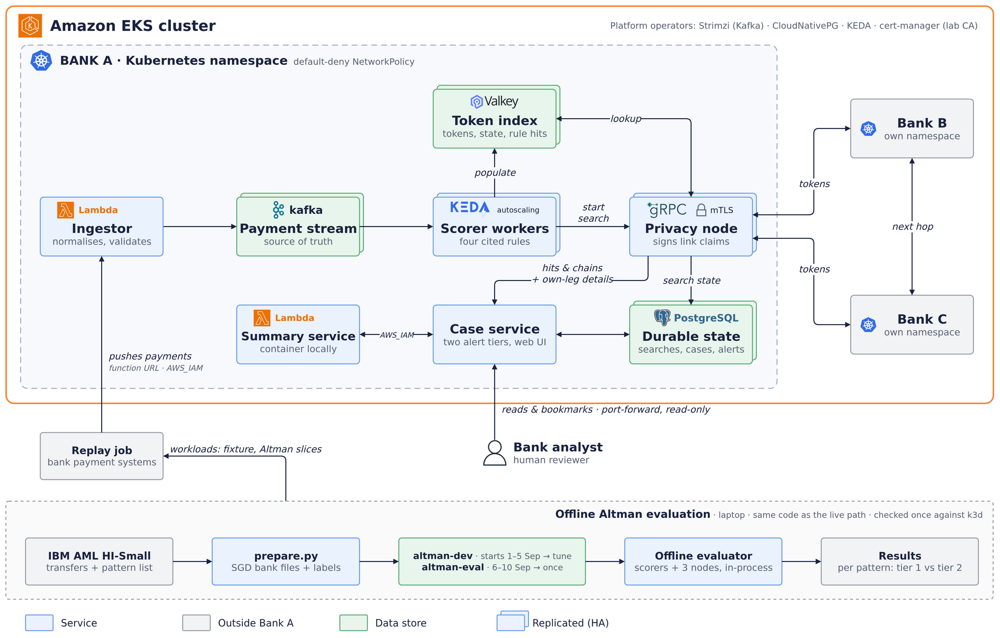

# Overview

CSC3104 Cloud and Distributed Computing: **Privacy Preserving Detection of Cross-Bank Money Mule Chains**.

## Problem

Money mules pass funds through accounts to hide where the money came from. Each bank sees only its own transfers, so a chain through several banks is split across organisations. In Singapore, "mule bank accounts are used to electronically move the scam monies between different banks, and out of the country" ([SPF, MAS, IMDA and GovTech, 17 Sep 2025](https://www.mas.gov.sg/news/media-releases/2025/joint-press-release-by-spf-mas-imda-and-govtech-on-restricting-access-to-facilities-for-scam-mules)). Singapore's banks already share information on customers who show several red flags through [COSMIC](https://www.mas.gov.sg/regulation/anti-money-laundering/cosmic), a platform MAS launched in 2024. This project looks at a different design: peer to peer, with no platform in the middle that holds every bank's data.

Three simulated banks cooperate to find these chains, while customer details and payment records stay inside each bank. The output is a case for each bank's own analyst, showing which banks' rules confirmed each link, with a template summary draft for human review.

## Goals

- Trace a mule chain across three banks in real time, peer to peer, with **no central coordinator**, including for key setup.
- Keep raw customer and payment fields out of interbank messages. Banks exchange only opaque transfer tokens and signed link claims.
- Keep detecting among the remaining banks when one bank is offline.
- Keep exactly **one durable case per bank per chain**, despite delayed or repeated messages, retries and restarted pods. Push an alert only when at least two banks' own rules fired.
- Measure detection quality offline against labelled data, and latency, scaling and recovery on the cluster.

## Requirements

The module sets these requirements.

| Requirement | How it is met | Where to look |
| --- | --- | --- |
| Containers and/or Kubernetes (mandatory); containerised and tested | One image runs every service. One Helm chart per bank, on k3d and on Amazon EKS. Unit tests run in CI, and 57 checks run against the live cluster. | [Dockerfile](../Dockerfile), [deploy/charts/bank](../deploy/charts/bank), [checks.yml](../.github/workflows/checks.yml), [deploy/test_cluster.py](../deploy/test_cluster.py), [evaluation.md](evaluation.md#results) |
| Original distributed contribution | A peer-to-peer search for cross-bank chains with no central hub, in which each bank signs only its own link. Pair keys are agreed between banks (X25519), not issued by a dealer. | [node.py](../src/mulechain/node/node.py) `search`, `Trace`; [crypto.py](../src/mulechain/crypto.py) `pair_keys`; [protocol.md](protocol.md) |
| Concurrency (interference, memory consistency) | **Interference** is prevented by ownership and locks: each scorer replica owns its partitions, one privacy-node replica at a time does the background work, and one lock guards case creation, while searches run side by side in a thread pool. **Consistency** comes from transactions: an event's state and its offset are written together in Valkey, and a chain and the messages it owes together in PostgreSQL. | [scorer.py](../src/mulechain/scorer.py) `process`, `resume`; [node.py](../src/mulechain/node/node.py) `pool`, `run_searches`; [case/store.py](../src/mulechain/case/store.py) `JOIN_LOCK`; patterns [2](patterns.md#2-partition-ownership-and-autoscaling-on-lag), [3](patterns.md#3-the-delivery-chain-and-idempotent-receivers), [7](patterns.md#7-advisory-locks) |
| Use of cloud services | Amazon EKS, ECR, Lambda (ingestor and summary service), ElastiCache, KEDA autoscaling, CloudWatch for the Lambda logs. | [deploy/terraform](../deploy/terraform), [serverless.py](../src/mulechain/serverless.py), [deployment.md](deployment.md#aws) |
| Concurrent housekeeping tasks | Each node retries searches with capped, jittered backoff and expiry, and redelivers its outbox with dead letters. One replica at a time does this, under a PostgreSQL advisory lock. | [node.py](../src/mulechain/node/node.py) `work_once`; [node/store.py](../src/mulechain/node/store.py) `housekeeping`, `backoff`; patterns [5](patterns.md#5-retry-with-capped-backoff-full-jitter-and-expiry), [6](patterns.md#6-transactional-outbox-and-dead-letters), [7](patterns.md#7-advisory-locks) |
| Fault and failure handling | An offline bank leaves the searches that need it pending until it returns or they expire. Kafka, PostgreSQL and the privacy node run replicas in the HA bank. A lost Valkey is rebuilt from the Kafka log with `make rebuild`. | [protocol.md](protocol.md#failure-handling), [detection.md](detection.md#rebuilding-valkey-from-the-log), [evaluation.md](evaluation.md#results) |
| Server callbacks / server-to-client communication | A finished chain is pushed to every bank that signed part of it (`Deliver`, acknowledged), and each node pushes its hits and chains to its case service through an outbox. | [node.py](../src/mulechain/node/node.py) `Deliver`, `deliver`; [case/app.py](../src/mulechain/case/app.py) `POST /messages`; pattern [6](patterns.md#6-transactional-outbox-and-dead-letters) |
| Quantitative evaluation | Detection quality offline against Altman's labels; correctness, scaling and recovery on the cluster. | [evaluate.py](../src/mulechain/evaluate.py), [evaluation.md](evaluation.md) |
| No sophisticated GUI needed | A read-only analyst page. | [case/app.py](../src/mulechain/case/app.py), [cases.md](cases.md) |
| Serverless functions (extra credit) | The ingestor and the summary service run on AWS Lambda, and as plain containers on k3d. | [serverless.py](../src/mulechain/serverless.py), [lambda.tf](../deploy/terraform/lambda.tf), [deployment.md](deployment.md#aws) |

## Patterns

The system is built from ten distributed-systems patterns ([patterns.md](patterns.md)):

1. [The log is the source of truth](patterns.md#1-the-log-is-the-source-of-truth)
2. [Partition ownership and autoscaling on lag](patterns.md#2-partition-ownership-and-autoscaling-on-lag)
3. [The delivery chain and idempotent receivers](patterns.md#3-the-delivery-chain-and-idempotent-receivers)
4. [Deadline propagation](patterns.md#4-deadline-propagation)
5. [Retry with capped backoff, full jitter and expiry](patterns.md#5-retry-with-capped-backoff-full-jitter-and-expiry)
6. [Transactional outbox and dead letters](patterns.md#6-transactional-outbox-and-dead-letters)
7. [Advisory locks](patterns.md#7-advisory-locks)
8. [Key agreement with no dealer](patterns.md#8-key-agreement-with-no-dealer)
9. [Zero trust](patterns.md#9-zero-trust)
10. [Bulkhead and graceful degradation](patterns.md#10-bulkhead-and-graceful-degradation)

## Scope

| In | Out |
| --- | --- |
| Three simulated banks: A, B, C | Training a detection model |
| Bounded **linear** chains: a search follows up to five transfers | Split payments, merged flows, broad graph discovery |
| Four transparent rules on bank transfers, two of them from published red flags; amounts in SGD | Live banking integration |
| IBM AML data with Altman's labels as ground truth; planted chains as acceptance tests ([data.md](data.md)) | Real freezes, holds or reports; analyst decisions |
| Read-only analyst page; template summary drafts | A sophisticated GUI |

A rule flags suspicion, not proven laundering.

## Architecture

Every bank runs the same services in its own Kubernetes namespace (Bank A shown). Replay stands outside the banks, in place of their payment systems.

1. **Replay** sends each transfer as an ISO 20022 pacs.008 message (the standard bank-to-bank credit transfer) to the **ingestor** of both banks involved. The ingestor validates it and writes `out` and `in` events to the bank's **Kafka** topic, keyed by account ([data.md](data.md)).
2. **Scorer workers** each own some of the topic's partitions and keep their state in **Valkey** (an in-memory key-value store, like Redis). KEDA, a Kubernetes add-on, adds workers as unread events build up. The workers index each cross-bank transfer under its token and apply four rules: fast pass-through, chain, new payee and quick repeat ([detection.md](detection.md)). A chain hit starts a search at the other banks, and every hit is shown to this bank's analyst.
3. The **privacy node** asks the next bank about the transfer by its token, over gRPC with mutual TLS (both sides present a certificate). Both banks on a transfer derive the same token from the shared payment ID, using a key the pair agreed ([security.md](security.md)). The bank that is asked checks its own records and its own rules. If they match, it replies with a signed claim linking the two tokens, and asks the bank after it ([protocol.md](protocol.md)).
4. A search stops at the hop limit or its deadline, and visited tokens stop loops. The bank that started it verifies the chain, stores it in **PostgreSQL** and delivers it to every bank that signed a claim.
5. Each node posts its hits and chains to its **case service** through an outbox (a table of messages still to send, written together with the data and resent until acknowledged). A chain on which at least two banks' rules fired is a **Tier 2 alert**. A hit or chain backed only by this bank's own rule is a **Tier 1** case, shown but not pushed ([cases.md](cases.md)). The analyst views and bookmarks cases and reads a draft from the **summary service**. What the bank then does is outside the system.

The offline evaluator runs the same scorer, node and case code in one process, with no cluster. A cluster run is checked by comparing its cases with the evaluator's ([evaluation.md](evaluation.md)).

## Docs

| Doc | Covers |
| --- | --- |
| [patterns.md](patterns.md) | The distributed-systems patterns, each with its code and how to see it work. Start here to read the code. |
| [data.md](data.md) | Dataset, bank split, workloads, replay, ingestor, event format |
| [detection.md](detection.md) | Kafka topic, the four rules, scorer, Valkey state, rebuild, autoscaling |
| [protocol.md](protocol.md) | Peer messages, the search, failure handling, delivery |
| [security.md](security.md) | Tokens, key agreement and rotation, signed claims, mTLS, network paths, what is still disclosed |
| [cases.md](cases.md) | Cases, alert tiers, analyst page, summary service |
| [deployment.md](deployment.md) | k3d and AWS, commands, settings, operations |
| [evaluation.md](evaluation.md) | Method, experiments, how to run them, results |

## Trust and failure model

- Kubernetes namespaces **simulate** separate banks. They are not a production security boundary: the banks share a node kernel, and DNS still answers for other namespaces' service names.
- Banks are authenticated by mTLS and sign their claims. A signature proves who made a claim and that it wasn't altered, **not** that the bank's records are true. Banks are assumed to apply the rules honestly.
- Tokens and claims still reveal limited relationships, such as which banks took part and in what order ([security.md](security.md#residual-disclosure)).
- A bank that is offline can't confirm a link. Searches that need it stay pending, retried with backoff, until it returns or they expire after 24 hours. Other searches continue.
- One shared lab CA and the published public keys are trusted ([security.md](security.md#trust-limits)).
- The guarantees hold after recovery with storage intact. Kafka is the source of truth and PostgreSQL holds the cases; losing either for good loses data.

## Technology

| Area | Choice | Why |
| --- | --- | --- |
| Language | Python 3.12, one package, `uv` | One language for every service, so the offline evaluator runs the cluster's own code |
| Streaming | [Kafka](https://kafka.apache.org/intro) ([Strimzi](https://strimzi.io/docs/operators/latest/overview), KRaft mode), confluent-kafka, [KEDA](https://keda.sh/docs/2.21/scalers/apache-kafka/) | A partitioned log that can be read again: order per account, state that can be rebuilt, scaling on lag |
| Payment messages | ISO 20022 pacs.008 subset as JSON; CloudEvents headers on Kafka records | The message banks use for a credit transfer, and a standard envelope for events |
| Protocol | [gRPC](https://grpc.io/docs/guides/deadlines/) and protobuf | Deadlines that travel with a call, mutual TLS, and a schema that fixes what may cross between banks |
| Cryptography | HMAC-SHA256 tokens, X25519 + HKDF key agreement, Ed25519 signatures (`cryptography`), [cert-manager](https://cert-manager.io/docs/) | Standard primitives ([security.md](security.md)), no cryptography of our own, and no party that hands out keys |
| Storage | Kafka (source of truth), [Valkey](https://valkey.io/) (derived, rebuildable state), PostgreSQL ([CloudNativePG](https://cloudnative-pg.io/documentation/current/)) | The log is the truth, Valkey is fast and can be rebuilt, PostgreSQL gives transactions and locks for what must not be lost |
| Platform | k3d locally, Amazon EKS, AWS Lambda, ElastiCache, Helm, [helmfile](https://helmfile.readthedocs.io/en/latest/), Terraform, GitHub Actions | The same charts locally and on AWS, with managed services where the module asks for cloud services |
| Monitoring | No dedicated stack: `kubectl top`, KEDA/HPA status, consumer lag, CloudWatch for Lambda, JSON logs | Enough to measure every experiment without more to run |
