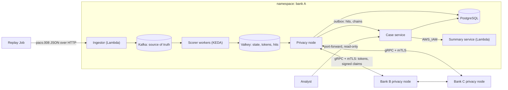

# Overview

> [!NOTE]
> This is the target design decided on 30 Oct 2026. Most of it is built; each contract lists any pending work.

## Problem

Money mules pass funds through accounts to hide where the money came from. Each bank sees only its own transfers, so a chain that passes through several banks is split across organisations. In Singapore, "mule bank accounts are used to electronically move the scam monies between different banks, and out of the country" (SPF/MAS/IMDA/GovTech, 17 Sep 2025).

We build a system in which simulated banks cooperate to find these chains, while customer details and payment records stay inside each bank. The output is a bank-local analyst case showing which banks' rules confirmed each link, with a template summary draft for human review.

## Goals

- Trace a mule chain across three banks in real time, peer to peer, with **no central coordinator**, including for key setup.
- Keep raw customer and payment fields out of interbank messages. Banks exchange only opaque transfer tokens and limited signed link claims.
- Keep detecting among the remaining banks when one bank is offline.
- Keep exactly **one durable case per bank per chain**, despite delayed or repeated messages, retries and restarted pods. Push an alert only when at least two banks' own rules fired. This is guaranteed after recovery with intact storage, not after permanent data loss.
- Measure detection quality offline against labelled data, and latency, scaling and recovery on the cluster.

## Requirements

The module fixes these requirements; they override anything else in the docs.

| Requirement | How we meet it |
| --- | --- |
| Containers and/or Kubernetes (mandatory); containerised and tested | Per-bank Helm chart on k3d and EKS; one Dockerfile pattern; tested from a clean setup before submission |
| Original distributed contribution | Peer-to-peer cross-bank chain search with no central hub, and pair keys agreed between banks (X25519) rather than issued by a dealer |
| Concurrency (interference, memory consistency) | Scorer replicas with partition ownership and shared state in Valkey; overlapping searches; two privacy-node replicas sharing PostgreSQL; one durable case per bank and chain |
| Use of cloud services | EKS, ECR, AWS Lambda (ingestor, summary service), ElastiCache, KEDA autoscaling, CloudWatch |
| Concurrent housekeeping tasks | Retries with capped, jittered backoff and expiry; outbox redelivery with dead letters; one replica at a time under a PostgreSQL advisory lock |
| Fault and failure handling | An offline bank leaves dependent searches pending (outcome unknown) until it returns or they expire; replicas in the HA bank; recovery measured as RTO and RPO |
| Server callbacks / server-to-client communication | Results pushed to every involved bank (`Deliver`, with acknowledgements), and from each node to its case service through an outbox |
| Quantitative evaluation | [evaluation.md](evaluation.md) |
| No sophisticated GUI needed | Read-only analyst UI |

Serverless functions earn extra credit: the ingestor and the summary service run on AWS Lambda (plain containers locally).

## Scope

| Core | Extensions (only once core works) | Out of scope |
| --- | --- | --- |
| Three simulated banks: A, B, C | Split payments, merged flows | Training a detection model |
| Bounded **linear** chains | Broad graph discovery | Live banking integration |
| Four cited, transparent rules on cross-bank bank transfers; amounts in SGD | More banks | Real freezes, holds or reports; analyst decisions |
| IBM AML data with Altman's labels as ground truth; planted chains as acceptance tests ([data.md](contracts/data.md)) | Query rate limiting, signed audit log | Sophisticated GUI |
| Read-only analyst UI; template summary drafts | | |

A rule flags suspicion, not proven laundering.

## Architecture

Every bank runs the same services in its own Kubernetes namespace (Bank A shown). Replay stands outside the banks, in place of their payment systems.

1. **Replay** sends each transfer as an ISO 20022 pacs.008 message to the **ingestor** of both banks involved. The ingestor validates it and writes `out` and `in` events to the bank's **Kafka** topic, keyed by account ([data.md](contracts/data.md)).
2. **Scorer workers** each own some of the topic's partitions and keep their state in **Valkey**. They index each cross-bank transfer under its token and apply four rules to cross-bank bank transfers (GIRO and MEPS+): fast pass-through, chain, new payee and quick repeat ([streaming.md](contracts/streaming.md)). A pass-through or chain link starts a search; a chain, new payee or quick repeat hit becomes local (Tier 1) suspicion.
3. The **privacy node** queries the next bank with the transfer's token. Both banks on a transfer derive the same token from the shared payment ID, using a key the pair agreed ([security.md](contracts/security.md)). The receiving bank checks its own records and applies its own rules. If they match, it replies with an Ed25519-signed claim linking the two tokens and forwards the query onward ([protocol.md](contracts/protocol.md)).
4. A search stops at the hop limit or its deadline, and visited tokens stop loops. The initiator verifies the chain, stores it in PostgreSQL and delivers it to every bank that signed a claim.
5. Each node posts its hits and chains to its **case service** through an outbox. A chain on which at least two banks' rules fired is a **Tier 2 alert**; everything else is a **Tier 1** case, shown but not pushed and ranked by the number of rules fired ([case.md](contracts/case.md)). The analyst views and bookmarks cases and reads a summary draft. What the bank then does is outside the system.

## Trust and failure model

- Kubernetes namespaces **simulate** separate banks. They are not a production security boundary: the banks share a node kernel, and DNS still answers for other namespaces' service names.
- Banks are authenticated by mTLS and sign their claims. A signature proves who made a claim and that it wasn't altered, **not** that the bank's records are true. Banks are assumed to apply the rules honestly.
- Tokens and claims still reveal limited relationships, such as which banks took part and in what order ([security.md](contracts/security.md#residual-disclosure)).
- A bank that is offline can't confirm a link. Searches that need it stay pending, retried with backoff, until it returns or they expire after 24 h. Other searches continue.
- One shared lab CA and the published public keys are trusted, which is a stated limitation.

## Technology stack

| Area | Choice |
| --- | --- |
| Language | Python (uv workspace) |
| Streaming | Kafka (Strimzi, KRaft mode), confluent-kafka, KEDA |
| Payment messages | ISO 20022 pacs.008 subset as JSON; CloudEvents headers on Kafka records |
| Protocol | gRPC and protobuf |
| Cryptography | HMAC-SHA256, X25519 + HKDF key agreement, Ed25519 (`cryptography`), cert-manager, Kubernetes Secrets |
| Storage | Kafka (source of truth), Valkey (derived, rebuildable state), PostgreSQL (CloudNativePG) |
| Platform | k3d (local), Amazon EKS, AWS Lambda, Helm, GitHub Actions |
| Monitoring and evaluation | No dedicated stack: metrics-server (`kubectl top`), KEDA/HPA status, Kafka consumer-group lag, CloudWatch for Lambda, JSON logs; pandas, matplotlib |

## Deadlines

| Event | Date (2026) |
| --- | --- |
| Progress presentation (live progress check) | Tue 27 Oct |
| Final submission (working system, tested in containers) | Fri 20 Nov, 23:59 |
| Dell Cloud Native Award presentation (top 3 teams only) | Wed 2 Dec |
