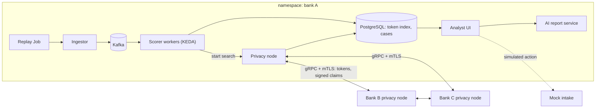

# Overview

## Problem

Money mules pass funds through accounts to hide where the money came from. Each bank sees only its own transfers, so a chain that passes through several banks is split across organisations.

We build a system in which simulated banks cooperate to find these chains, while customer details and payment records stay inside each bank. The output is an analyst case showing which banks confirmed each link, plus an AI-assisted draft report for human review.

## Goals

- Trace a mule chain across three banks in real time, peer to peer, with **no central coordinator**.
- Keep raw customer and payment fields out of interbank messages. Banks exchange only opaque transfer tokens and limited signed link claims.
- Keep detecting among the remaining banks when one bank is offline.
- Raise exactly **one durable alert per involved bank** per chain, despite delayed or repeated messages, retries and restarted pods. This is guaranteed after recovery with intact storage, not after permanent data loss.
- Measure detection quality, latency, scaling and recovery.

## Requirements

The module fixes these requirements; they override anything else in the docs.

| Requirement | How we meet it |
| --- | --- |
| Containers and/or Kubernetes (mandatory); containerised and tested | Per-bank Helm chart on k3d and EKS; tested from a clean setup before submission |
| Original distributed contribution | Peer-to-peer cross-bank chain search with no central hub |
| Concurrency (interference, memory consistency) | Concurrent scorer replicas, overlapping searches, a durable unique alert per bank and chain |
| Use of cloud services | EKS, container registry, autoscaling |
| Concurrent housekeeping tasks | Bounded retries, redelivery of pending notifications, expiry of query state |
| Fault and failure handling | An offline bank leaves dependent traces partial; recovery after restarts |
| Server callbacks / server-to-client communication | Confirmed results pushed to every involved bank, with acknowledgements |
| Quantitative evaluation | [evaluation.md](evaluation.md) |
| No sophisticated GUI needed | Minimal analyst UI |

Serverless functions would earn extra credit but are not planned.

## Scope

| Core | Extensions (only once core works) | Out of scope |
| --- | --- | --- |
| Three simulated banks: A, B, C | Split payments, merged flows | Training a detection model |
| Bounded **linear** chains | Broad graph discovery | Live banking integration |
| Transparent rules, USD only | More banks | Real freezes, holds or reports |
| Synthetic data with planted chains ([data.md](contracts/data.md)) | Query rate limiting, signed audit log | Sophisticated GUI |
| Small analyst UI; AI draft report with human review | | |

A rule flags suspicion, not proven laundering.

## Architecture

Every bank runs the same services in its own Kubernetes namespace (Bank A shown).

1. **Replay** sends one bank's payment events, in time order, to its **ingestor**, which publishes them to the bank's **Kafka** ([data.md](contracts/data.md), [streaming.md](contracts/streaming.md)).
2. **Scorer workers** index each transfer under its token. A transfer is suspicious when a large share of the incoming value moves on within a time window; the scorer then starts a search.
3. The **privacy node** queries the next bank with the transfer's token. Both banks on a transfer derive the same token from the shared payment ID, using a key for that bank pair ([security.md](contracts/security.md)). The receiving bank checks its own records and applies the rule locally. If it matches, it replies with an Ed25519-signed claim linking the two tokens and forwards the query onward ([protocol.md](contracts/protocol.md)).
4. A search stops at the hop limit or its deadline. Visited tokens are recorded so a search can't loop.
5. Confirmed results become **bank-local cases**, with one alert at each involved bank ([case.md](contracts/case.md)). An analyst reviews the case and the draft report, then chooses a simulated action: monitor, suspend outgoing transfers, freeze accounts, or report to the authorities (the **mock intake**).

## Trust and failure model

- Kubernetes namespaces **simulate** separate banks. They are not a production security boundary.
- Banks are authenticated by mTLS and sign their claims. A signature proves who made a claim and that it wasn't altered, **not** that the bank's records are true. Banks are assumed to apply the rule honestly.
- Tokens and claims still reveal limited relationships, such as which banks took part and in what order ([security.md](contracts/security.md#residual-disclosure)).
- A bank that is offline can't confirm a link. Searches that need it stay partial, and other searches continue.

## Technology stack

| Area | Choice |
| --- | --- |
| Language | Python (uv workspace) |
| Streaming | Kafka (Strimzi, KRaft mode), confluent-kafka, KEDA |
| Protocol | gRPC and protobuf |
| Cryptography | HMAC-SHA256, Ed25519 (`cryptography`), cert-manager, Kubernetes Secrets |
| Storage | PostgreSQL |
| Platform | k3d (local), Amazon EKS, Helm, GitHub Actions |
| Monitoring and evaluation | Prometheus, Grafana, pandas, matplotlib |

## Deadlines

| Event | Date (2026) |
| --- | --- |
| Progress presentation (live progress check) | 29 Oct |
| Final submission (working system, tested in containers) | 15 Nov, 23:59 |
